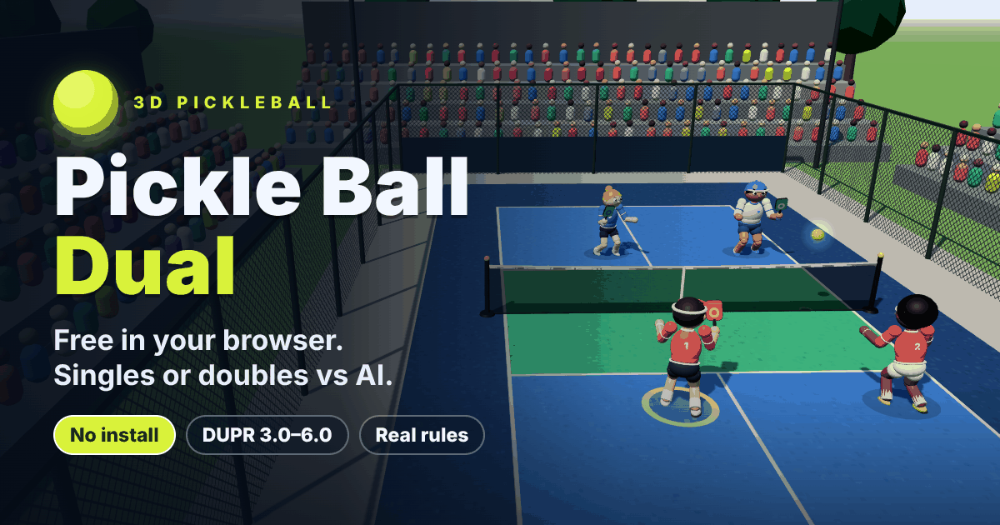

# Pickle Ball Dual

A free 3D pickleball game that runs in your browser: singles or doubles against AI opponents at DUPR levels 3.0 to 6.0, with real pickleball rules. No install, no sign-up.

**Play: https://ultralabed.github.io/Pickle-Ball-Dual/**



Guides (static pages, readable without JavaScript): [How to play](https://ultralabed.github.io/Pickle-Ball-Dual/how-to-play/) · [Rules](https://ultralabed.github.io/Pickle-Ball-Dual/rules/) · [FAQ](https://ultralabed.github.io/Pickle-Ball-Dual/faq/) · [繁體中文](https://ultralabed.github.io/Pickle-Ball-Dual/zh-tw/)

## Features

- Doubles (you + AI partner vs two AI) or singles
- AI opponents at DUPR 3.0, 4.0, 5.0 and 6.0 (partner level selectable in doubles)
- Traditional side-out scoring to 11 (doubles start at 0-0-2, server 1 and 2) and rally scoring to 15, win by 2
- Real rules: diagonal serve, two-bounce rule, kitchen (non-volley zone), faults, lines are in
- Shots: drive, drop, dink, lob, automatic smash on high balls, automatic around-the-post (ATP)
- Foot-ring timing colours, slow-motion instant replays, English referee score calls
- Touch controls for phones and tablets (floating joystick + Drive / Drop / Dink / Lob buttons), landscape and portrait, wake lock, optional full screen
- English and Traditional Chinese (繁體中文) interface
- Plain ES modules, three.js vendored, no build step

## Controls

| Action | Keys |
|---|---|
| Move | `W` `A` `S` `D` or arrow keys |
| Drive (hold to charge) | `Space` |
| Drop / Dink / Lob | `J` / `K` / `L` |
| Aim left / right (hold as you hit) | `A` `D` or `←` `→` |
| Serve | any hit key (`Space` fast, `L` lob, `J`/`K` soft) |
| Pause / Mute / Hide hints / Skip replay | `Esc` / `M` / `H` / `R` |

Phones and tablets get on-screen touch controls automatically (landscape and portrait):

| Action | Touch |
|---|---|
| Move | Floating joystick: touch and drag anywhere on the left ~45 % of the screen (up = toward the net) |
| Drive (hold to charge, release to hit) | Big pink **Drive** button; the ring on the button shows the charge |
| Drop / Dink / Lob | Green **Drop**, purple **Dink**, blue **Lob** buttons (trigger on touch down) |
| Aim left / right | Keep the joystick pushed left or right (past the arrow) as you hit |
| Serve | Any shot button (Drive fast, Lob high, Drop / Dink soft) |
| Pause / sound / full screen / skip replay | Top-right buttons / tap anywhere |

The touch overlay follows the last input type used: it shows when the primary pointer is coarse or after a touch, and hides again as soon as a key or mouse is used (`?controls=touch` / `?controls=keys` pins it). First-run graphics default to Low on phones, Medium on tablets and High on desktop. Add the page to your home screen for a full-screen game (`manifest.webmanifest`, `display: standalone`).

## Daily Pickleball Challenge (每日匹克球挑戰)

A second, one-minute game mode on the same 3D court: `daily/` (open `http://localhost:8000/daily/`).

- Five skill shots a day, picked from 20 challenge types by the local date (day #1 = 2026-11-18), the same five for everyone, no server.
- Pull back and release to hit (touch or mouse); up to 3 balls per shot, best ball counts, 0 to 100 points by distance to the target, total out of 500.
- Result with an emoji row and a copyable share text; progress is saved after every ball, so a reload cannot retry. Streak and best score are kept.
- "All challenges" (☰) lets you practise any of the 20 directly. Practice never changes the daily result. `daily/?practice=<id>` opens one directly.

| File | What it is |
|---|---|
| `src/daily/challenges.js` | **The content.** The 20 challenge types as data: id, zh/en name and instruction, parameter generator, scoring rule. Add an entry to add a challenge. |
| `src/daily/engine.js` | Pure engine: ball flight (the game's own integrator plus wind, defenders, bucket), scoring helpers, and the solver that rerolls any setup a perfect player cannot score 95 on (or whose perfect shot is a knife edge). |
| `src/daily/day.js` | Which five a date gets, save format, share text. `SHARE_URL` is the one constant for the shared link. |
| `src/daily/main.js`, `props.js`, `daily.css` | Shell, 3D props (targets, defender reach, bucket, aim preview), styles. Reuses `src/render`, `src/ui/audio.js`, `src/ui/i18n.js` (`daily.*` keys), `src/ui/store.js`. |

```sh
node --test tests/daily.test.mjs          # content + solver tests (part of npm test)
node dev/daily/solve-all.mjs 200          # solver sweep: every type over 200 seeds
node dev/daily/playtest.mjs --shots=/tmp/daily-shots   # Playwright: all 20 in practice + a full day, phone size, real drags
node dev/daily/bundle.mjs out.html        # one self-contained HTML file (needs npx esbuild)
```

## Run locally

```sh
python3 -m http.server 8000     # then open http://localhost:8000/
```

Any static server works. Every URL in the site is relative, so it also works under a sub-path.

## Tests

```sh
npm test                         # simulation tests + daily challenge tests (node --test)
node dev/playtest/menus.mjs      # Playwright UI playtests (need Playwright + Chromium)
node dev/playtest/i18n.mjs
node dev/playtest/touch.mjs [--shots]   # phone / tablet emulation with real multi-touch events (CDP)
node dev/seo/check.mjs --shots=/tmp/seo-shots   # SEO/AEO checker (add --full to run all of the above too)
```

## Project layout

```
index.html           game page (generated SEO head block between seo:begin / seo:end)
src/sim/             pure deterministic simulation (rules, scoring, AI)
src/render/          three.js view         src/ui/   menus, HUD, i18n, audio, voice
src/main.js          shell: loop, input, replay
vendor/              three.js (r170)
how-to-play/ rules/ faq/ zh-tw/   static guide pages (generated)
guide.css            shared stylesheet of the guide pages
sitemap.xml robots.txt llms.txt manifest.webmanifest 404.html og-image.png favicon.svg icon-*.png
dev/seo/             generators and checker for all of the above
dev/playtest/        Playwright playtests
SPEC.md              build spec
```

## SEO / AEO files and how to change the site URL

The guide pages, `sitemap.xml`, `robots.txt`, `llms.txt`, `404.html`, `manifest.webmanifest` and the SEO `<head>` block of `index.html` are generated:

```sh
node dev/seo/build.mjs                                  # regenerate everything
node dev/seo/build.mjs --base=https://example.com/      # build for a custom domain
node dev/seo/make-images.mjs [icons|og|all]             # regenerate og-image.png and the PNG icons (Playwright)
```

The canonical base URL is defined in one place: `BASE_URL` in `dev/seo/site.mjs` (the `--base` flag overrides it). To move to a custom domain: change `BASE_URL` (and the `--base` default of `dev/seo/check.mjs` follows it), add a `CNAME` file, rebuild, and run the checker. Absolute URLs only appear in generated canonical / hreflang / Open Graph / JSON-LD / sitemap / robots / llms.txt / 404.html output; everything else stays relative. Edit the copy in `dev/seo/content-en.mjs` and `dev/seo/content-zh.mjs` (guide pages) and the `meta.*` strings in `src/ui/i18n.js` (the home page tags that follow the UI language; keep the English ones equal to `HOME_EN` in `dev/seo/site.mjs`).

Note: crawlers only read `robots.txt` at the host root; on a project sub-path rely on the sitemap and meta robots tags, or serve the site from a custom domain.

## License and credit

[MIT](LICENSE) © 2026 [Edward Shih](https://www.linkedin.com/in/edward-shih-43942786). You may use, copy, modify and redistribute this project, including commercially, as long as the copyright notice and license text stay with it. A link back to this repository or to [Edward's LinkedIn](https://www.linkedin.com/in/edward-shih-43942786) is appreciated.

three.js (vendored in `vendor/`) is © Three.js Authors, also MIT.
